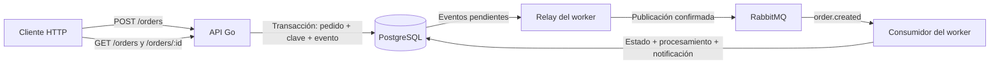

# EventFlow

API de pedidos en Go con procesamiento asíncrono. La API persiste el pedido y
un evento en PostgreSQL; un worker publica el evento en RabbitMQ, lo consume,
actualiza el pedido y registra una notificación simulada.

## Arquitectura



La API y el worker son procesos separados. El worker ejecuta el relay de outbox
y el consumidor en paralelo; la notificación se guarda en la base de datos, no
se envía un correo real.

El código se organiza en `cmd/` para el arranque y ensamblado, `internal/`
para dominio, casos de uso y adaptadores, `pkg/` para componentes compartidos y
  `migrations/` para el esquema. La documentación Swagger está en `doc/`.

Las migraciones activas están agrupadas en `001_orders` (pedidos), `002_events`
(outbox y consumidor) y `003_idempotency`.

**Cambio incompatible con el historial anterior:** las migraciones fueron
consolidadas. Una base que aplicó las versiones anteriores no debe actualizarse
directamente con el nuevo historial. En una instalación local cuyos datos se
puedan descartar, sigue los pasos de reinicialización de abajo. Para cualquier
base cuyos datos deban conservarse se necesita una estrategia de transición y
respaldo; no basta con cambiar la versión de `schema_migrations`.

## Requisitos

- Go 1.26 o compatible con la versión indicada en `go.mod`.
- Docker y Docker Compose, con el motor Docker iniciado.
- Puertos libres: 8080 para la API, 5433 para PostgreSQL, 5672 para AMQP y
  15672 para la consola de RabbitMQ.

Los comandos siguientes son para PowerShell y se ejecutan desde la raíz del
repositorio. Las credenciales de ejemplo son solo para desarrollo local.

## Ejecución local

1. Si todavía no tienes `.env.dev`, crea una copia de ejemplo:

   ```powershell
   Copy-Item .env.example .env.dev
   ```

   Si ya existe, revísalo en vez de sobrescribirlo. Comprueba que `DB_USER`,
   `DB_PASSWORD` y `DB_NAME` coincidan para la aplicación y Compose. En una
   instalación nueva puedes conservar `DB_PASSWORD=change-me` del ejemplo: se
   pasará a Compose mediante `--env-file`. Usa `DB_PORT=5433` y
   `DB_HOST=127.0.0.1` para procesos Go ejecutados en el host. El healthcheck
   de Compose espera el usuario y la base `eventflow`.

   Las variables de entorno del proceso tienen prioridad sobre `.env.dev` en la
   aplicación y pueden afectar también la interpolación de Compose. Si ya
   existe un volumen PostgreSQL, cambiar la contraseña en `.env.dev` **no cambia**
   automáticamente la contraseña almacenada en ese volumen; utiliza las
   credenciales existentes o actualízalas de forma explícita y segura.

2. Levanta PostgreSQL y RabbitMQ y aplica las migraciones activas:

   ```powershell
   docker compose --env-file .env.dev up -d postgres rabbitmq
   docker compose --env-file .env.dev run --rm migrate
   ```

3. En terminales separadas, inicia la API y el worker:

   ```powershell
   go run ./cmd/api
   ```

   ```powershell
   go run ./cmd/worker
   ```

   La API escucha por defecto en `http://localhost:8080`; Swagger está disponible
   en `http://localhost:8080/swagger/index.html` fuera de producción. La consola
   local de RabbitMQ está en `http://localhost:15672` (usuario y contraseña de
   desarrollo predeterminados: `guest` / `guest`).

Para detener dependencias sin borrar los datos persistidos:

```powershell
docker compose --env-file .env.dev down
```

### Reinicializar una base local existente

**Esto elimina permanentemente los datos de todos los volúmenes declarados por
este proyecto Compose**, incluidos pedidos, eventos y claves de idempotencia.
Solo úsalo cuando estés seguro de no necesitar conservarlos. Detén primero los
procesos locales de API y worker con `Ctrl+C`, y luego ejecuta:

```powershell
docker compose --env-file .env.dev down --volumes
docker compose --env-file .env.dev up -d postgres rabbitmq
docker compose --env-file .env.dev run --rm migrate
```

Después inicia nuevamente API y worker en terminales separadas como se indicó
arriba. La opción `--volumes` no debe usarse para el apagado habitual.

## Configuración

La aplicación usa `.env.dev` por defecto; con `ENVIRONMENT=qa` utiliza
`.env.qa` y con `ENVIRONMENT=prod` toma la configuración del entorno. Las
variables del sistema prevalecen sobre las del archivo. Consulta
`.env.example` para los nombres y valores de ejemplo.

| Variables | Función |
|---|---|
| `ENVIRONMENT`, `PORT` | Entorno y puerto HTTP. |
| `DB_HOST`, `DB_PORT`, `DB_USER`, `DB_PASSWORD`, `DB_NAME`, `DB_SSL_MODE` | Conexión a PostgreSQL. |
| `AMQP_URL` | Conexión del worker a RabbitMQ. |
| `LOG_LEVEL`, `LOG_FORMAT` | Nivel y formato de logs (`json` o `console`). |
| `REQUEST_TIMEOUT`, `SHUTDOWN_TIMEOUT` | Límites de peticiones y apagado. |
| `OUTBOX_POLL_INTERVAL`, `OUTBOX_BATCH_SIZE`, `PUBLISH_CONFIRM_TIMEOUT` | Lectura y publicación del outbox. |
| `CONSUMER_PREFETCH` | Límite de entregas pendientes del consumidor. |

No subas secretos reales al repositorio ni reutilices credenciales de ejemplo en
producción.

## API

| Método | Ruta | Descripción |
|---|---|---|
| GET | `/healthz` | Informa el estado de la conexión a la base. |
| POST | `/orders` | Crea un pedido; requiere `Idempotency-Key`. |
| GET | `/orders` | Lista pedidos. |
| GET | `/orders/:id` | Consulta un pedido por UUID. |

Ejemplo de creación en PowerShell:

```powershell
$headers = @{ 'Idempotency-Key' = 'pedido-demo-001' }
$body = @'
{
  "customer_id": "cliente-1",
  "items": [
    { "product_id": "producto-1", "quantity": 2, "unit_price_minor": 1500 }
  ]
}
'@
Invoke-RestMethod -Method Post -Uri http://localhost:8080/orders -Headers $headers -ContentType 'application/json' -Body $body
```

La respuesta inicial es `201`, contiene `id`, `status` y `total_minor`, y
proporciona la cabecera `Location`. El estado inicial es `pending`; tras el
procesamiento, consulta el estado actual con:

```powershell
Invoke-RestMethod http://localhost:8080/orders/ID_DEL_PEDIDO
Invoke-RestMethod http://localhost:8080/orders
Invoke-RestMethod http://localhost:8080/healthz
```

Reemplaza `ID_DEL_PEDIDO` por el valor recibido. Actualmente `/healthz`
responde `200` incluso si PostgreSQL no está disponible; el campo `database`
indica `connected` o `disconnected`. No es una comprobación de readiness.

### Idempotencia

`Idempotency-Key` es obligatoria y admite de 1 a 128 caracteres ASCII: letras,
números, `.`, `_`, `~` y `-`. Una clave ausente o inválida produce `400`.
Repetir la clave con los mismos datos normalizados devuelve la **respuesta
inicial** sin crear otro pedido ni otro evento; con datos diferentes responde
`409`. Para una operación nueva, usa otra clave. Las claves son globales, se
almacenan como huellas SHA-256 y actualmente no vencen. Más detalles en
[`doc/idempotency.md`](doc/idempotency.md).

## Eventos, confirmaciones y reintentos

- El pedido, sus artículos, la clave de idempotencia y el evento de outbox se
  guardan en una misma transacción. Así, si RabbitMQ no está disponible al crear
  el pedido, el evento permanece en PostgreSQL para su publicación posterior.
- El relay marca el evento publicado después de una confirmación positiva del
  broker. Si la publicación falla, guarda el intento y programa otra oportunidad
  con espera creciente. Una caída entre la publicación y el marcado puede causar
  una publicación duplicada: no se garantiza entrega exactamente una vez.
- El consumidor intenta procesar hasta cuatro veces en memoria, con esperas de
  1, 2 y 4 segundos. Registra el procesamiento y la notificación en una
  transacción; las restricciones de unicidad ayudan a evitar efectos duplicados.
- Un procesamiento exitoso o duplicado se confirma con **ACK**. Al agotar los
  intentos, se registra el fallo en `failed_events` y luego se confirma con ACK.
  Un evento inválido se registra en `rejected_deliveries` y se rechaza con
  **NACK sin reencolar**. Si no se puede guardar el resultado, la entrega queda
  sin confirmar y se cierra el canal, permitiendo su redelivery por RabbitMQ.
- El log «confirmación pendiente» refleja la decisión del consumidor, no una
  garantía de que el ACK ya haya sido enviado.

## Tests

```powershell
go test ./...
go vet ./...
go build ./...
```

Los tests HTTP de handlers no necesitan levantar PostgreSQL ni RabbitMQ:

```powershell
go test ./internal/health/presentation/handler ./internal/order/presentation/handler
```

También existen tests unitarios de casos de uso y del consumidor. El repositorio
actual no incluye un test de integración automatizado del flujo completo con
PostgreSQL y RabbitMQ ni de idempotencia con PostgreSQL.
Ver [`doc/tests-http.md`](doc/tests-http.md) para los tests HTTP.

## Escenarios de fallo para demostrar

Los siguientes son **procedimientos propuestos**, no evidencia de una ejecución
en este README. Ejecútalos en un entorno local de prueba y conserva los
resultados y logs para la entrega. No detengas servicios compartidos.

### 1. RabbitMQ no disponible al crear un pedido

1. Con la API, worker y dependencias locales funcionando, detén RabbitMQ:
   `docker compose --env-file .env.dev stop rabbitmq`.
2. Crea un pedido con una clave nueva y guarda su ID. La API utiliza PostgreSQL
   para persistirlo; el evento debería permanecer sin publicar en el outbox.
   El worker puede detenerse por la pérdida de conexión.
3. Consulta en PostgreSQL, sustituyendo el ID:

   ```sql
   SELECT order_id, event_type, published_at, publish_attempts
   FROM outbox_events WHERE order_id = 'ID_DEL_PEDIDO';
   ```

4. Inicia RabbitMQ con `docker compose --env-file .env.dev start rabbitmq`.
   Cuando esté listo, reinicia el worker si se detuvo. Consulta el pedido y el
   outbox hasta observar `processed` y `published_at` con valor. Si no ocurre,
   conserva los logs y registra el resultado real como limitación.

### 2. PostgreSQL no disponible

1. En un entorno local aislado, detén PostgreSQL:
   `docker compose --env-file .env.dev stop postgres`.
2. Consulta `/healthz`: se espera `database: disconnected`. Intenta crear un
   pedido con una clave nueva: debe fallar sin devolver un pedido creado ni
   exponer credenciales o SQL en la respuesta. El worker puede detenerse.
3. Restaura PostgreSQL con `docker compose --env-file .env.dev start postgres`;
   espera a que esté listo y reinicia el worker si es necesario. Reintenta con
   la misma clave y consulta el pedido. Documenta el resultado observado.

Detener contenedores no borra el volumen. Evita `down -v` si necesitas conservar
los datos locales.

## Limitaciones y siguientes pasos

- El contador de reintentos del consumidor no sobrevive al reinicio del worker.
- Varios relays pueden seleccionar el mismo evento; faltan reclamación segura
  entre workers y tests de concurrencia del relay.
- La reconexión automática del worker ante una caída del broker no está
  garantizada; puede ser necesario reiniciarlo.
- La correlación completa entre solicitud HTTP y evento, métricas, readiness y
  tests de integración de ACK/NACK y apagado quedan pendientes.
- Las claves de idempotencia no tienen caducidad; se necesita una política de
  retención antes de un uso prolongado.
- No hay envío de notificaciones real, autenticación ni configuración de
  producción lista para desplegar.
